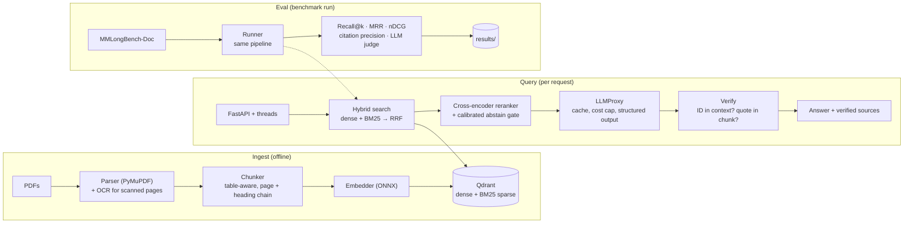
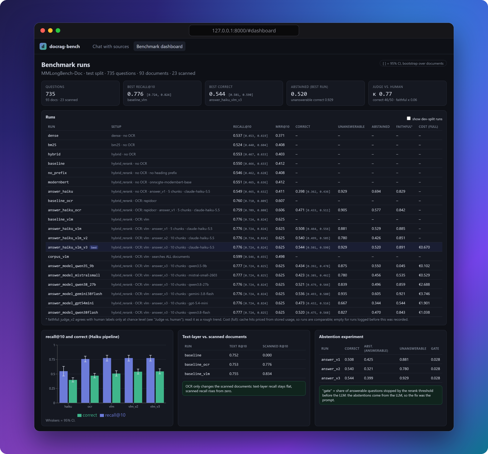

<p align="center">
  <a href="https://huggingface.co/spaces/Quexoo/docrag-bench"></a>
</p>

<p align="center">
  <a href="https://github.com/byQuexo/docrag-bench/actions/workflows/ci.yml"></a>
  
  <a href="LICENSE"></a>
  <a href="https://huggingface.co/spaces/Quexoo/docrag-bench"></a>
  <a href="docs/lessons/README.md"></a>
</p>

<p align="center">
  <a href="https://huggingface.co/spaces/Quexoo/docrag-bench"></a>
  &nbsp;
  <a href="#learn-with-this-repo"></a>
</p>

<p align="center">
  
  <br>
  <sub>Measured on <a href="https://huggingface.co/datasets/yubo2333/MMLongBench-Doc">MMLongBench-Doc</a>, test split: 735 questions over 93 PDFs, 23% unanswerable on purpose. 95% confidence intervals are bootstrapped over documents.<br>The judge agrees with human labels on 46/50 (Cohen's κ 0.77). Scanned PDFs: 152 questions on 23 image-only PDFs. The +3.6 points come from the abstention experiment: the prompt, not the threshold, was the problem. → <a href="#results">Results</a> · <a href="#learnings">Learnings</a></sub>
</p>

## Try it

**Live demo: [huggingface.co/spaces/Quexoo/docrag-bench](https://huggingface.co/spaces/Quexoo/docrag-bench)**. Pick a sample PDF or upload your own (up to 60 pages), ask a question, and get the answer with verified page citations, the retrieved evidence and the cited page. Answers come from the open model Qwen3.8-27B on free ZeroGPU hardware: no API key, the GPU time comes from each visitor's daily Hugging Face quota. Expect a wait: the GPU is lent per question, and the first question about a new PDF also indexes it. The same demo runs locally ([demo/README.md](demo/README.md)).

## Two ways to use this repo

| Run the benchmark | Learn RAG + Python by doing |
|---|---|
| Index the PDFs, run the experiment configs, get a results table with confidence intervals. [Quickstart](#quickstart) | 13 lessons with interactive notebooks: you type small steps yourself and the real modules run. [Lessons](#learn-with-this-repo) |

## What makes it different

Most RAG frameworks return an answer as a plain string, so you can't tell which sentence came from where. docrag-bench returns **structured evidence**:

```json
{
  "answer": "Europe grew from 41.0 to 45.5 million EUR [report:p2:c1].",
  "evidence": [{ "id": "report:p2:c1", "quote": "Europe 41.0 45.5" }]
}
```

`Verify` then checks every citation in pure code, without an extra LLM call:

1. **Is the ID real?** The cited chunk must be one the LLM was actually given.
2. **Is the quote real?** After normalization, the quote must appear verbatim in that chunk.

Failed citations are removed; if none survive, the answer is labelled `unsupported` instead of being presented as sourced. When nothing relevant is retrieved, or the question doesn't fit the document, the system says **"Not answerable"** instead of guessing.

## Architecture


Three paths share one core: **Ingest** fills Qdrant, **Query** answers questions, and **Eval** calls exactly the same retriever and answer service as the API.

<details>
<summary>Detailed component diagram (Mermaid)</summary>


</details>


*Chat with sources (a real question from the benchmark): the answer with `[p.X]` citations, the verified quotes, and the retrieved evidence after reranking with chunk type and score. If the document doesn't contain the answer, it says "Not answerable" and why.*

## Results

<p align="center">
  
  
</p>

<p align="center">
  
  <br>
  <sub>The benchmark dashboard of the <a href="ui/README.md">web UI</a>: every number is computed live from <code>results/</code>.</sub>
</p>

Test split: 735 questions over 93 documents (split by document; thresholds and prompt variants were chosen on the dev split, with one exception: `answer_v3` was picked over `answer_v2` as the headline after both had run on test, see the abstention experiment). Search is scoped to the question's document. `results/` holds every run's config, per-question CSV, metrics and `run.json` (git commit, index versions, latency, cost). Brackets are 95% CIs, bootstrapped over documents (2,000 reps, seed 0); reproduce with `uv run docrag summary`.

**Answers** (Claude Haiku 5.5 via OpenRouter, judged by DeepSeek V4.1 Flash with `judge_v2`):

| variant | correct | answerable | unanswerable | tables | charts | scanned PDFs | faithful | citation precision |
|---|---|---|---|---|---|---|---|---|
| hybrid + rerank + LLM | 0.398 [0.362, 0.436] | 0.239 | 0.929 | 0.272 | 0.105 | 0.282 | 0.829 | 0.677 |
| + OCR (RapidOCR) | 0.471 [0.433, 0.511] | 0.342 | 0.905 | 0.390 | 0.220 | 0.531 | 0.842 | 0.740 |
| + OCR (vision LLM) | 0.508 [0.464, 0.556] | 0.397 | 0.881 | 0.390 | 0.309 | 0.653 | 0.885 | 0.762 |
| + prompt `answer_v2`, 10 chunks | 0.540 [0.499, 0.585] | **0.469** | 0.780 | **0.566** | **0.357** | **0.667** | 0.851 | 0.764 |
| **+ prompt `answer_v3`, 10 chunks** | **0.544** [0.501, 0.590] | 0.430 | **0.929** | 0.500 | 0.328 | 0.657 | **0.891** | **0.790** |

"Correct" counts abstaining on an unanswerable question as correct. "Faithful" is averaged over the answers the judge model read (answerable, not abstained). Citation precision is the share of verified citations that point at a gold evidence page.

**How far the judge can be trusted:** `judge_v2` agreement with human labels (50 answers, blind): **correct 46/50 (Cohen's κ 0.77)**, **faithful 40/50 (Cohen's κ 0.06)**. "Correct" is reliable; the "faithful" column is not reliable for single answers (judge and human each mark 10–14% as unfaithful, but rarely the same ones), so read it as a rough trend at best.

<details>
<summary><b>Retrieval table</b>: dense, BM25, hybrid, rerank, embedding size, OCR</summary>

**Retrieval** (recall@10; documents with a text layer: 413 answerable questions; scanned: 152):

| variant | recall@1 | recall@10 | MRR@10 | recall@10, scanned PDFs |
|---|---|---|---|---|
| dense (gte-small) | 0.271 | 0.735 [0.672, 0.794] | 0.508 | 0.000 |
| BM25 (sparse + IDF) | 0.313 | 0.716 [0.656, 0.775] | 0.558 | 0.000 |
| hybrid (RRF, k=60) | 0.302 | 0.756 [0.702, 0.809] | 0.551 | 0.000 |
| hybrid + rerank | 0.330 | 0.752 [0.692, 0.808] | 0.563 | 0.000 |
| hybrid + rerank, no heading prefix | 0.327 | 0.747 [0.684, 0.803] | 0.558 | 0.000 |
| hybrid + rerank, gte-modernbert-base (768 dim) | 0.333 | 0.754 [0.695, 0.809] | 0.563 | 0.000 |
| hybrid + rerank + RapidOCR | 0.330 | 0.753 [0.694, 0.811] | 0.562 | 0.776 [0.658, 0.861] |
| hybrid + rerank + vision-LLM OCR | 0.334 | 0.755 [0.694, 0.812] | 0.564 | **0.834** [0.723, 0.911] |
</details>

<details>
<summary><b>Experiments</b>: OCR, abstention, chatbot mode, answer-model comparison (full table and caveats)</summary>

- **OCR.** 28 of 134 PDFs are image-only (mostly slide decks); without OCR the system can't see them. OCR takes recall@10 over all questions from 0.550 to 0.776, the biggest single gain in the project. The vision LLM beats RapidOCR mainly on charts (correct 0.220 → 0.309), because it binds numbers to their labels. It cost 0.42 EUR for 1,390 pages.
- **Abstention.** The first answer runs abstained on ~43% of answerable questions, although the gold page was often in the top 5. A new column (`abstained_before_llm`) showed the rerank gate stops only 2.8%; the LLM itself was saying "Not answerable". Variants were compared on dev, only the winners ran on test. `answer_v2` (combine passages, read tables, do arithmetic) + 10 chunks answers more (answerable +48/−7, p < 0.0001) but also answers questions whose premise is false (unanswerable 1 gained, 18 lost). `answer_v3` adds "answer exactly what was asked; false premise → *Not answerable*": unanswerable back to 0.929 (+25/−0 vs v2), answerable 0.430 (3 gained, 25 lost vs v2). v2 and v3 tie overall (p = 0.78). Note that this choice was made with both test results in view, the one place where test numbers influenced a decision; v3 is the headline because it abstains honestly and has the best citation precision (its faithfulness is also highest, but see the judge caveat above).
- **Chatbot mode (search all documents).** All numbers above search only the question's own PDF. Asking across all 134 indexed PDFs, like a company chatbot (`scope: corpus`, `configs/corpus_vlm.yaml`), recall@10 drops from 0.776 to **0.599** [0.546, 0.655]: −0.177, CI [−0.211, −0.143] (text-layer 0.755 → 0.567, scanned 0.834 → 0.687). Answer quality in this mode is not benchmarked yet. The web UI and the API support it ("All documents").
- **Answer-model comparison.** Same index, retrieval, prompt (`answer_v3`, 10 chunks) and judge; only the answer model changes (configs `answer_model_*.yaml`). Paired McNemar against Haiku on the same 735 questions:

  | answer model | correct | vs Haiku | unanswerable | failed answers* | LLM p50 / p95 | EUR per 100 questions |
  |---|---|---|---|---|---|---|
  | **Claude Haiku 5.5** | **0.544** [0.501, 0.590] | – | 0.929 | 0.0% | 2.2 s / 7.4 s | **0.09** |
  | Gemini 3.8 Flash | 0.536 [0.493, 0.580] | −0.8 pts (p = 0.47, n.s.) | 0.935 | 0.1% | 4.6 s / 16 s | 0.51 |
  | Qwen3.8-27B | 0.521 [0.479, 0.566] | −2.3 pts (p = 0.036) | 0.839 | 6.8% | 5.0 s / 49 s | 0.37 |
  | Qwen3.8 Flash | 0.520 [0.475, 0.568] | −2.4 pts (p = 0.020) | 0.827 | 5.6% | 10.1 s / 68 s | 0.14 |
  | GPT-5.4 mini | 0.473 [0.432, 0.516] | −7.1 pts (p < 0.001) | 0.667 | 0.0% | 1.4 s / 7.0 s | 0.26 |
  | Qwen3.5-9B | 0.434 [0.392, 0.478] | −11.0 pts (p < 0.001) | 0.875 | 0.0% | 0.9 s / 5.9 s | 0.01 |
  | Mistral Small 2603 | 0.423 [0.385, 0.462] | −12.1 pts (p < 0.001) | 0.780 | 0.0% | 1.0 s / 6.4 s | 0.07 |

  \* empty or invalid JSON after one retry, counted as wrong. The Qwen3.8 models are reasoning models: with the same 4,096-token limit as every other model, they sometimes spend it all on hidden reasoning and return nothing. (Provider rate-limit errors were re-run from the cache, so they don't count.)

  Two caveats: `answer_v3` was developed with Haiku, so other models may do better with their own prompt; and there is one judge model. Haiku and Gemini 3.8 Flash are statistically tied; Gemini has the best faithfulness and citation precision, but costs about 5.6× as much. GPT-5.4 mini mostly loses on unanswerable questions: it answers where it should abstain (0.667 vs 0.929). The best open models trail Haiku by 2–3 points, are slower and fail on ~6–7% of questions. Qwen3.5-9B often gets the answer right but rarely quotes verbatim: Verify rejected the citations of 93% of its answers, so they come back as `unsupported`. That is exactly what Verify is for.
</details>

## Learnings

- **OCR only helps on PDFs without a text layer.** On text-layer documents recall@10 stays at 0.752 / 0.753 / 0.755 (no OCR / RapidOCR / vision LLM); on scanned ones it goes 0.000 → 0.776 → 0.834. Look at the data before tuning models. → [lesson 12](docs/lessons/12_ocr.md)
- **The LLM abstains, not the threshold.** Only 2.8% of answerable questions were stopped by the rerank gate. The fix was the prompt. → [lesson 08](docs/lessons/08_eval.md)
- **The more expensive model doesn't win.** Haiku and Gemini 3.8 Flash are statistically tied on correctness (0.544 vs 0.536, p = 0.47), but Gemini costs about 5.6× as much per question. Measure before paying for the bigger model. → [lesson 05](docs/lessons/05_llm_proxy.md)
- **A small model can be right and still unsourced.** Qwen3.5-9B answers many questions correctly, but Verify rejected the citations of 93% of its answers because the quotes weren't verbatim. Without Verify those answers would look sourced. → [lesson 06](docs/lessons/06_answer_and_verify.md)
- **Knowing the document is worth 18 points of recall.** Searching all 134 PDFs instead of the right one drops recall@10 from 0.776 to 0.599. A chatbot over many documents needs better retrieval (or document routing) before it matches the per-document numbers. → [lesson 03](docs/lessons/03_embeddings_and_search.md)

<details>
<summary>5 more learnings</summary>

- **Reranker, heading prefix and a 2× larger embedding model: no significant effect on retrieval.** Paired differences in recall@10 are within ±0.005, every CI includes 0; even the reranker's recall@1 gain (+0.028) is not significant. The reranker still costs ~0.5 s per query on GPU (p50 499 ms). → [lesson 04](docs/lessons/04_rerank_and_threshold.md)
- **Hybrid search beats BM25 (recall@10 +0.040, significant) and dense at the top of the ranking** (MRR +0.044, significant); against dense on recall@10 the gain is not significant. → [lesson 03](docs/lessons/03_embeddings_and_search.md)
- **Check the judge before you trust the score.** A quote-only judge (`judge_v1`) put faithfulness at 0.46–0.50; with the full cited passages (`judge_v2`) it is 0.83–0.89. Against human labels, though, `judge_v2` agrees on correctness (κ 0.77) but its faithfulness verdicts are at chance level (κ 0.06). Earlier, averaging abstentions as "faithful" had made a metric artifact look like an OCR effect. → [lesson 08](docs/lessons/08_eval.md)
- **Reasoning models need their own token budget.** With the same 4,096-token output limit as every other model, both Qwen3.8 models sometimes spend it all on hidden reasoning and return nothing: no answer on 6–7% of questions. In production that means a separate, larger budget (or reasoning turned off) for reasoning models, and monitoring for empty responses. → [lesson 05](docs/lessons/05_llm_proxy.md)
- **One number hides trade-offs.** v2 and v3 have the same overall correctness, but v2 gets 3.9 points more answerable questions right and v3 14.9 points more unanswerable ones. → [lesson 08](docs/lessons/08_eval.md)
</details>

<details>
<summary>More notes on the results</summary>

- **Judge reliability:** judge failures (invalid JSON after one retry) are counted (`judge_failed`, 2–3 of 735 per run). Agreement with human labels is measured with `docrag label-sample` → `docrag label` → `docrag judge-agreement`; the 50 labels are in `results/human_labels/`. Faithfulness was the hard part for the human too: when retrieval missed part of the evidence, "every claim is in the cited passages" depends on how strictly the passages are read.
- **Costs:** `run.json` reports `cost_eur_billed` (what was charged; cache hits are free) and `cost_eur_full` (cache hits priced from their stored usage, comparable across runs). The `answer_v3` test run: 0.67 EUR full. All LLM calls in the project so far, including the answer-model comparison: ~14 EUR.
- **Dataset quirks:** 1,091 questions, 135 documents in the QA set, 134 PDFs downloadable (744 test questions in the split, 735 with a PDF). One question appears twice on the same document with contradictory gold answers ("46%" and "Not answerable"); paired tests align runs by row, not by question ID.
- **Reproducibility:** re-running a config from the cache gives the same metrics; 2 of 735 answers were regenerated because retrieval returned a slightly different chunk set (probably GPU nondeterminism, not verified).
- **Latency (GPU, `answer_v3`):** search p50 6 ms, rerank p50 499 ms, LLM p50 2.2 s, whole answer p50 2.8 s / p95 6.2 s.
- The retrieval runs were made before `run.json` recorded the git commit.
</details>

<details>
<summary>How it's measured: experiment axes and metrics</summary>

One YAML in `configs/` = one row in the results table; the config hash is written into every result folder.

| Axis | Values | Config field |
|---|---|---|
| Embedding model | `gte-small` (384) vs `gte-modernbert-base` (768) | `embedder` |
| Retrieval | dense · BM25 · hybrid RRF · hybrid RRF + rerank | `retrieval` |
| OCR | none · RapidOCR · vision LLM | `ocr`, `ocr_model` |
| Heading prefix | heading chain in `embed_text` off · on | `prefix_headings` |
| Prompt, context size | `answer_v1`/`v2`/`v3`, 5 or 10 chunks | `prompt_version`, `context_k` |
| Verify | off · on (same answers, no extra LLM call) | reported side by side |

| Metric | Level | How |
|---|---|---|
| Recall@1/5/10, MRR@10, nDCG@10 | page | own helpers, tested against hand calculations |
| Citation precision | answer | share of citations on a gold page, Verify off vs on |
| Correct, faithful | answer | LLM judge (`judge_v2`, sees the cited passages); rules for "Not answerable" |
| CIs, significance | run | bootstrap over documents; paired McNemar |
| Latency p50/p95, cost | run | `@timed` decorator (cache hits timed separately), usage from the proxy |
</details>

## Learn with this repo

The code was written by Claude; architecture, evaluation and review are by Tim. The lessons were built from that process: each explains one stage, and each notebook lets you rebuild a piece of it with the real modules (offline, fakes only, a few seconds per notebook).

<p align="center">
  <a href="docs/lessons/00_setup_and_tooling.md"></a>
  <a href="docs/lessons/01_shared_foundations.md"></a>
  <a href="docs/lessons/02_ingest.md"></a>
  <a href="docs/lessons/03_embeddings_and_search.md"></a>
  <a href="docs/lessons/04_rerank_and_threshold.md"></a>
  <a href="docs/lessons/05_llm_proxy.md"></a>
  <a href="docs/lessons/06_answer_and_verify.md"></a>
  <br>
  <a href="docs/lessons/07_api_and_threads.md"></a>
  <a href="docs/lessons/08_eval.md"></a>
  <a href="docs/lessons/09_testing_ci_docker.md"></a>
  <a href="docs/lessons/10_interview_prep.md"></a>
  <a href="docs/lessons/11_gpu_secrets_security.md"></a>
  <a href="docs/lessons/12_ocr.md"></a>
  <a href="docs/lessons/13_tracing.md"></a>
</p>

<details>
<summary>All lessons: topics, Python concepts, notebooks, real modules</summary>

| # | Topic | Python concepts | Notebook | Real module |
|---|---|---|---|---|
| 00 | [Setup and tooling](docs/lessons/00_setup_and_tooling.md) | packages vs. modules, top-level `await` | [notebook](notebooks/lessons/00_setup_and_tooling.ipynb) | `wiring.py`, `cli.py` |
| 01 | [Shared foundations](docs/lessons/01_shared_foundations.md) | frozen Pydantic models, validators | [notebook](notebooks/lessons/01_shared_foundations.ipynb) | `shared/schema.py`, `shared/cache.py` |
| 02 | [Ingest](docs/lessons/02_ingest.md) | generators, `itertools.groupby` | [notebook](notebooks/lessons/02_ingest.ipynb) | `ingest/parser.py`, `ingest/chunker.py` |
| 03 | [Embeddings and hybrid search](docs/lessons/03_embeddings_and_search.md) | `Protocol`, registries | [notebook](notebooks/lessons/03_embeddings_and_search.ipynb) | `embed/`, `store/qdrant.py` |
| 04 | [Reranking and the threshold](docs/lessons/04_rerank_and_threshold.md) | `sorted(key=...)`, comprehensions | [notebook](notebooks/lessons/04_rerank_and_threshold.ipynb) | `rerank/reranker.py` |
| 05 | [The LLM proxy](docs/lessons/05_llm_proxy.md) | ABCs, decorators | [notebook](notebooks/lessons/05_llm_proxy.ipynb) | `llm/proxy.py` |
| 06 | [Answers and Verify](docs/lessons/06_answer_and_verify.md) | structured output, string handling | [notebook](notebooks/lessons/06_answer_and_verify.ipynb) | `answer/verify.py` |
| 07 | [API and threads](docs/lessons/07_api_and_threads.md) | FastAPI `TestClient`, locks | [notebook](notebooks/lessons/07_api_and_threads.ipynb) | `api/app.py`, `threads/store.py` |
| 08 | [Evaluation](docs/lessons/08_eval.md) | `statistics`, bootstrap | [notebook](notebooks/lessons/08_eval.ipynb) | `eval/metrics.py`, `eval/stats.py` |
| 09 | [Testing, CI, Docker](docs/lessons/09_testing_ci_docker.md) | pytest `parametrize` | [notebook](notebooks/lessons/09_testing_ci_docker.ipynb) | `tests/`, `ci.yml` |
| 10 | [Interview prep](docs/lessons/10_interview_prep.md) | – | – | everything |
| 11 | [GPU, secrets, security](docs/lessons/11_gpu_secrets_security.md) | `os.environ`, `SecretStr` | [notebook](notebooks/lessons/11_gpu_secrets_security.ipynb) | `shared/settings.py` |
| 12 | [OCR](docs/lessons/12_ocr.md) | `ThreadPoolExecutor`, the GIL | [notebook](notebooks/lessons/12_ocr.ipynb) | `ingest/ocr.py` |
| 13 | [Tracing](docs/lessons/13_tracing.md) | context managers | [notebook](notebooks/lessons/13_tracing.ipynb) | `shared/tracing.py` |

Solutions are in `notebooks/lessons/solutions/`; CI executes them so they stay in sync with the code.

<details>
<summary>Design decisions</summary>

- **PyMuPDF, not Docling.** It parses a 50-page PDF in seconds on CPU without ML models and detects ruled tables. Docling has better layout quality but needs PyTorch and is far slower. The parser sits behind a `Parser` protocol; a second parser is only added if a benchmark justifies it.
- **ONNX Runtime, not PyTorch.** About 50 MB instead of several GB, and the same model files run on CPU or CUDA. Pooling and truncation are implemented by hand, small and tested.
- **Hybrid search inside Qdrant.** Dense and BM25 prefetch branches fused with **RRF**, which only uses ranks, so cosine and BM25 scores never need calibrating. The RRF constant is explicit (`rrf_k: 60`), because Qdrant's default is k = 2.
- **BM25 = sparse vectors + `Modifier.IDF`.** Qdrant's full-text payload index only filters, it doesn't rank. TF and length normalization are computed at index time, IDF at query time.
- **Our own LLM proxy instead of LiteLLM.** Routing, format conversion, caching, cost accounting and the budget cap in about 300 tested lines. LiteLLM would be the pragmatic choice with many providers and could be swapped in behind the same `Provider` interface.
- **Structured output plus exactly one retry.** A Pydantic schema as `response_format`, one retry with the validation error, then a counted hard failure. No regex JSON repair.
- **Verify in pure code.** Deterministic, free, and runs on the same answers for the on/off comparison.
- **Tuned on dev, reported on test, split by document.** Questions about one PDF never end up in both splits. One exception, stated openly: `answer_v3`'s rules came from dev errors, but choosing it over `answer_v2` as the headline happened with both test results visible.
- **Page-level metrics.** The ground truth is evidence pages, so ranked chunks are mapped to unique pages, which keeps chunkers comparable.
- **Versioned index.** The Qdrant collection name carries a fingerprint of parser, chunker, embedder and OCR versions; a change means a fresh index instead of silently reusing old chunks.
- **Tracing only on the query path.** `@timed` opens an OpenTelemetry span only *inside* a trace, so ingest records nothing. The `@timed` percentiles still feed `run.json`, so benchmark numbers don't depend on a tracing backend.
- **Content-addressed caches** (parse, OCR, embed, LLM): content hash + component version + options, never paths or secrets.
</details>

<details>
<summary>Known limitations</summary>

- **Charts and figures are hard for a text retriever.** Only captions, labels and OCR/VLM descriptions are indexed; a ColPali-style visual retriever is future work.
- Verify checks that quotes are *real*, not that they *support* the claim (no entailment check).
- `answer_v2`/`v3` were developed with Haiku; other answer models may need their own prompt. There is one judge model.
- Heading detection is a font-size heuristic; decorative text produces noisy heading chains.
- PyMuPDF is **AGPL-3.0**, which matters for closed-source redistribution.
- BM25 tokenization is English-only, without stemming; term IDs are `crc32` hashes (rare collisions possible).
- Threads are in-memory and lost on restart. Follow-up questions are not rewritten before retrieval. Searching all documents at once retrieves clearly worse than searching the right one (recall@10 0.599 vs 0.776).
- Qdrant's embedded mode is brute force and slow beyond roughly 20k chunks; use the Docker server for full runs.
</details>

<details>
<summary>Future work</summary>

- **Next:** a more reliable faithfulness check (a second judge model, or more human labels); a model-based support check (LettuceDetect) as a second Verify stage; deploying the demo as a Space.
- **Later:** a judge panel across providers; Promptfoo as an eval gate in CI; Redis for threads and cache; a ColPali-style visual retriever; German as an evaluation axis.
</details>

<details>
<summary>Project layout</summary>

```
docrag-bench/
├── src/docrag/
│   ├── shared/     # settings, schema, cache, timing, tracing, IDs, config
│   ├── ingest/     # parser, OCR (RapidOCR, vision LLM), chunker, indexer
│   ├── embed/      # Embedder protocol, EmbeddingService, ONNX + fake
│   ├── store/      # Qdrant collections, BM25 sparse vectors, hybrid search, retriever
│   ├── rerank/     # cross-encoder + threshold calibration
│   ├── llm/        # proxy, pricing, providers (OpenAI-compatible, Anthropic, fake)
│   ├── answer/     # context, Answer schema, Verify, AnswerService
│   ├── threads/    # ThreadStore interface + in-memory implementation
│   ├── api/        # FastAPI routes (wiring only)
│   ├── eval/       # dataset, metrics, stats, judge, agreement, runner, calibration
│   ├── prompts/    # versioned prompt files
│   ├── wiring.py   # builds the object graph from settings + config
│   └── cli.py      # `docrag` command
├── demo/          # Gradio demo (local or Hugging Face Space)
├── ui/            # web UI: chat with sources + benchmark dashboard (Vite, React)
├── notebooks/lessons/  # interactive lessons (+ solutions/)
├── docs/lessons/       # lesson texts
├── tests/          # unit/ against fakes, e2e/ against a real Qdrant
├── configs/        # one YAML per experiment
├── results/        # per run: config.yaml, metrics.csv, per_question.csv, run.json
├── compose.yaml    # Qdrant + API + Phoenix
└── pyproject.toml  # uv, ruff, mypy (strict), pytest
```
</details>

<details>
<summary>Development</summary>

```bash
uv run ruff check . && uv run ruff format --check .
uv run mypy src                                   # strict mode
uv run pytest -m "not e2e"                        # unit tests, no services needed
uv run pytest --nbmake notebooks/lessons/solutions # lesson notebooks
DOCRAG_E2E_QDRANT_URL=http://localhost:6333 uv run pytest -m e2e   # needs Qdrant
```

CI (GitHub Actions) runs lint, types, unit tests and the lesson notebooks; an end-to-end test against a Qdrant service container; and a Docker build.
</details>
</details>

## Quickstart

Requirements: Python 3.12, [uv](https://docs.astral.sh/uv/), Docker for Qdrant. Works on Windows and Linux/macOS.

```bash
uv sync --extra cpu                          # or --extra gpu (CUDA wheels, no system CUDA needed)
uv run python scripts/download_data.py       # MMLongBench-Doc PDFs + questions -> data/
docker compose up -d qdrant && uv run docrag eval configs/baseline.yaml
```

`eval` indexes missing documents itself and prints the results table (`uv run docrag summary` prints it again, with CIs). Retrieval-only configs need no API key. For answers, set an LLM route in the config (`llm: provider:model`, e.g. `openrouter:anthropic/claude-haiku-5.5` with `OPENROUTER_API_KEY`); all LLM calls are cached, and a run stops at `DOCRAG_BUDGET_EUR` (default 5 EUR).

- **Ask one question:** `uv run docrag ask --config configs/answer_haiku_vlm_v3.yaml --doc <doc_id> "question"`
- **API:** `uv run docrag serve --config configs/answer_haiku_vlm_v3.yaml` → http://127.0.0.1:8000/docs
- **Run the Gradio demo locally:** `uv sync --extra cpu --extra demo`, then `uv run python demo/app.py` → http://127.0.0.1:7860
- **Start the web UI:** `cd ui && npm install && npm run build`, then `uv run docrag serve --config configs/answer_haiku_vlm_v3.yaml` → http://127.0.0.1:8000 (chat) and http://127.0.0.1:8000/#dashboard. Or `docker compose up -d`, same URL. For UI development: `npm run dev` in `ui/` (port 5173, proxies the API).

<details>
<summary>More setup: LLM providers, Qdrant without Docker, tracing</summary>

| Option | Setup | Route example |
|---|---|---|
| OpenRouter (used for all results) | `OPENROUTER_API_KEY` | `openrouter:anthropic/claude-haiku-5.5` |
| Local (free) | install [Ollama](https://ollama.com), `ollama pull qwen3:8b` | `ollama:qwen3:8b` |
| OpenAI / Gemini / Groq / Mistral / DeepSeek | `OPENAI_API_KEY` / `GEMINI_API_KEY` / ... | `openai:<model>` |
| Anthropic | `ANTHROPIC_API_KEY` | `anthropic:claude-haiku-5-5` |

Keys can go in a git-ignored `.env` or the OS keyring (`uv run keyring set docrag OPENROUTER_API_KEY`).

**Qdrant without Docker:** `DOCRAG_QDRANT_LOCATION=./qdrant_storage` uses the embedded mode. It's brute-force search, fine for a few documents.

**Everything in Docker:** `docker compose up -d` starts Qdrant, the API with the web UI on port 8000 and Phoenix on port 6006. Answers need `OPENROUTER_API_KEY` in `.env` (no OS keyring in the container).

**Tracing:** with `DOCRAG_OTEL_ENDPOINT=http://127.0.0.1:6006/v1/traces`, every `serve` request, `ask` call and `eval` question becomes an OpenTelemetry trace in Phoenix (embed, search, rerank, the LLM call with tokens and cost, Verify). Ingest is deliberately not traced.
</details>

<details>
<summary>Design decisions</summary>

- **PyMuPDF, not Docling.** It parses a 50-page PDF in seconds on CPU without ML models and detects ruled tables. Docling has better layout quality but needs PyTorch and is far slower. The parser sits behind a `Parser` protocol; a second parser is only added if a benchmark justifies it.
- **ONNX Runtime, not PyTorch.** About 50 MB instead of several GB, and the same model files run on CPU or CUDA. Pooling and truncation are implemented by hand, small and tested.
- **Hybrid search inside Qdrant.** Dense and BM25 prefetch branches fused with **RRF**, which only uses ranks, so cosine and BM25 scores never need calibrating. The RRF constant is explicit (`rrf_k: 60`), because Qdrant's default is k = 2.
- **BM25 = sparse vectors + `Modifier.IDF`.** Qdrant's full-text payload index only filters, it doesn't rank. TF and length normalization are computed at index time, IDF at query time.
- **Our own LLM proxy instead of LiteLLM.** Routing, format conversion, caching, cost accounting and the budget cap in about 300 tested lines. LiteLLM would be the pragmatic choice with many providers and could be swapped in behind the same `Provider` interface.
- **Structured output plus exactly one retry.** A Pydantic schema as `response_format`, one retry with the validation error, then a counted hard failure. No regex JSON repair.
- **Verify in pure code.** Deterministic, free, and runs on the same answers for the on/off comparison.
- **Tuned on dev, reported on test, split by document.** Questions about one PDF never end up in both splits. One exception, stated openly: `answer_v3`'s rules came from dev errors, but choosing it over `answer_v2` as the headline happened with both test results visible.
- **Page-level metrics.** The ground truth is evidence pages, so ranked chunks are mapped to unique pages, which keeps chunkers comparable.
- **Versioned index.** The Qdrant collection name carries a fingerprint of parser, chunker, embedder and OCR versions; a change means a fresh index instead of silently reusing old chunks.
- **Tracing only on the query path.** `@timed` opens an OpenTelemetry span only *inside* a trace, so ingest records nothing. The `@timed` percentiles still feed `run.json`, so benchmark numbers don't depend on a tracing backend.
- **Content-addressed caches** (parse, OCR, embed, LLM): content hash + component version + options, never paths or secrets.
</details>

<details>
<summary>Known limitations</summary>

- **Charts and figures are hard for a text retriever.** Only captions, labels and OCR/VLM descriptions are indexed; a ColPali-style visual retriever is future work.
- Verify checks that quotes are *real*, not that they *support* the claim (no entailment check).
- `answer_v2`/`v3` were developed with Haiku; other answer models may need their own prompt. There is one judge model.
- Heading detection is a font-size heuristic; decorative text produces noisy heading chains.
- PyMuPDF is **AGPL-3.0**, which matters for closed-source redistribution.
- BM25 tokenization is English-only, without stemming; term IDs are `crc32` hashes (rare collisions possible).
- Threads are in-memory and lost on restart. Follow-up questions are not rewritten before retrieval. Searching all documents at once retrieves clearly worse than searching the right one (recall@10 0.599 vs 0.776).
- Qdrant's embedded mode is brute force and slow beyond roughly 20k chunks; use the Docker server for full runs.
</details>

<details>
<summary>Future work</summary>

- **Next:** a more reliable faithfulness check (a second judge model, or more human labels); a model-based support check (LettuceDetect) as a second Verify stage; deploying the demo as a Space.
- **Later:** a judge panel across providers; Promptfoo as an eval gate in CI; Redis for threads and cache; a ColPali-style visual retriever; German as an evaluation axis.
</details>

<details>
<summary>Project layout</summary>

```
docrag-bench/
├── src/docrag/
│   ├── shared/     # settings, schema, cache, timing, tracing, IDs, config
│   ├── ingest/     # parser, OCR (RapidOCR, vision LLM), chunker, indexer
│   ├── embed/      # Embedder protocol, EmbeddingService, ONNX + fake
│   ├── store/      # Qdrant collections, BM25 sparse vectors, hybrid search, retriever
│   ├── rerank/     # cross-encoder + threshold calibration
│   ├── llm/        # proxy, pricing, providers (OpenAI-compatible, Anthropic, fake)
│   ├── answer/     # context, Answer schema, Verify, AnswerService
│   ├── threads/    # ThreadStore interface + in-memory implementation
│   ├── api/        # FastAPI routes (wiring only)
│   ├── eval/       # dataset, metrics, stats, judge, agreement, runner, calibration
│   ├── prompts/    # versioned prompt files
│   ├── wiring.py   # builds the object graph from settings + config
│   └── cli.py      # `docrag` command
├── demo/          # Gradio demo (local or Hugging Face Space)
├── ui/            # web UI: chat with sources + benchmark dashboard (Vite, React)
├── notebooks/lessons/  # interactive lessons (+ solutions/)
├── docs/lessons/       # lesson texts
├── tests/          # unit/ against fakes, e2e/ against a real Qdrant
├── configs/        # one YAML per experiment
├── results/        # per run: config.yaml, metrics.csv, per_question.csv, run.json
├── compose.yaml    # Qdrant + API + Phoenix
└── pyproject.toml  # uv, ruff, mypy (strict), pytest
```
</details>

<details>
<summary>Development</summary>

```bash
uv run ruff check . && uv run ruff format --check .
uv run mypy src                                   # strict mode
uv run pytest -m "not e2e"                        # unit tests, no services needed
uv run pytest --nbmake notebooks/lessons/solutions # lesson notebooks
DOCRAG_E2E_QDRANT_URL=http://localhost:6333 uv run pytest -m e2e   # needs Qdrant
```

CI (GitHub Actions) runs lint, types, unit tests and the lesson notebooks; an end-to-end test against a Qdrant service container; and a Docker build.
</details>

## License

The code is MIT licensed. **Data:** the MMLongBench-Doc dataset card on Hugging Face does not state a license; the PDFs come from various public sources and are downloaded by `scripts/download_data.py`, not redistributed here. The models (`gte-small`: MIT; `gte-modernbert-base`, `gte-reranker-modernbert-base`: Apache-2.0) are downloaded at runtime.
