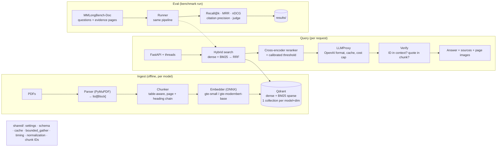
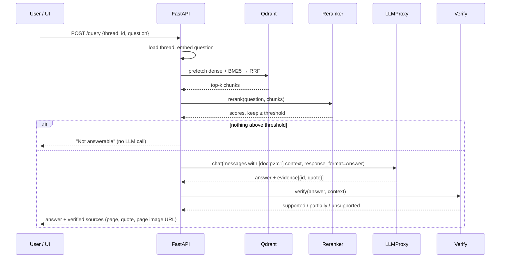

# docrag-bench

**Document RAG over real PDFs with hybrid retrieval, reranking and *verified* citations, plus a benchmark that shows with numbers which choices actually help.**

Questions about long PDFs (reports, 10-K filings, papers, manuals) are answered from retrieved passages. Every claim cites a chunk ID with a verbatim quote, and a pure-code verifier checks each citation before the answer is returned. The same pipeline is measured on [MMLongBench-Doc](https://huggingface.co/datasets/yubo2333/MMLongBench-Doc): 1,091 questions over 135 PDFs, about 22% of them deliberately unanswerable.

> Core question: *Which embedding model and which retrieval variant win, and does Verify make answers more honest?*

---

## What makes it different

Many RAG frameworks (e.g. RAG-Anything) return answers as plain strings: you can't tell which sentence came from where. docrag-bench returns **structured evidence**:

```json
{
  "answer": "Europe grew from 41.0 to 45.5 million EUR [report:p2:c1].",
  "evidence": [{ "id": "report:p2:c1", "quote": "Europe 41.0 45.5" }]
}
```

`Verify` then checks, without any extra LLM call:

1. **Is the ID real?** The cited chunk must be one of the chunks the LLM was actually given.
2. **Is the quote real?** After normalization, the quote must appear verbatim in that chunk.

Failed citations are removed. If none survive, the answer is labelled `unsupported` instead of being presented as sourced. Because Verify is free, the benchmark reports **citation precision with Verify off and on, over the *same* answers**.

---

## Architecture

Three paths share one core: **Ingest** fills Qdrant, **Query** answers questions, and **Eval** calls exactly the same retriever and answer service as the API.



### Query and citation flow



---

## Quickstart

Requirements: Python 3.12, [uv](https://docs.astral.sh/uv/), and optionally Docker (for Qdrant). Works on Windows (PowerShell) and Linux/macOS.

```bash
uv sync --extra gpu   # NVIDIA GPU (CUDA wheels via pip, no system CUDA needed)
# or: uv sync --extra cpu   # CPU only (what CI and Docker use)
uv run python scripts/download_data.py    # MMLongBench-Doc PDFs + questions -> data/
```

**Vector DB.** Pick one:

```bash
docker compose up -d qdrant               # Qdrant server on localhost:6333 (default)
```

or run without Docker using Qdrant's embedded mode. It's slower, but fine for a few documents:

```powershell
$env:DOCRAG_QDRANT_LOCATION = "./qdrant_storage"   # PowerShell
```
```bash
export DOCRAG_QDRANT_LOCATION=./qdrant_storage      # bash
```

**Index, evaluate, calibrate:**

```bash
uv run docrag ingest --config configs/baseline.yaml --docs 10   # first 10 PDFs
uv run docrag eval configs/retrieval_dense.yaml configs/retrieval_bm25.yaml \
                   configs/retrieval_hybrid.yaml configs/baseline.yaml
uv run docrag calibrate --config configs/baseline.yaml          # rerank threshold on the dev split
uv run docrag summary                                           # results table (Markdown)
```

`eval` indexes any missing documents itself. ONNX models are downloaded from Hugging Face on first use into `models/`.

**Answers need an LLM.** Set `llm:` (and optionally `judge:`) in a config, using the form `provider:model`:

| Option | Setup | Route example |
|---|---|---|
| Local (free) | install [Ollama](https://ollama.com), `ollama pull qwen3:8b` | `ollama:qwen3:8b` |
| Gemini free tier | `GEMINI_API_KEY=...` | `gemini:<model>` |
| OpenAI / Groq / Mistral / DeepSeek | `OPENAI_API_KEY` / `GROQ_API_KEY` / `MISTRAL_API_KEY` / `DEEPSEEK_API_KEY` | `openai:<model>` |
| Anthropic | `ANTHROPIC_API_KEY=...` | `anthropic:claude-haiku-5-5` |

Keys can go in a local `.env` file (git-ignored). Then:

```bash
uv run docrag ask --config configs/baseline.yaml --doc PH_2016.06.08_Economy-Final \
  "How many Latino respondents were foreign born?"
uv run docrag serve --config configs/baseline.yaml   # http://127.0.0.1:8000/docs
```

Or run everything with Docker: `docker compose up -d` (Qdrant + API on port 8000 + Phoenix traces on port 6006).

**Tracing.** Set `DOCRAG_OTEL_ENDPOINT=http://127.0.0.1:6006/v1/traces` (with `docker compose up -d phoenix`) and every `serve` request, `ask` call and `eval` question becomes an OpenTelemetry trace in Phoenix: embed, search, rerank, the LLM call (prompt, tokens, cost) and Verify (which citations were rejected and why). Ingest is deliberately not traced.

A paid run stops once `DOCRAG_BUDGET_EUR` (default 5 EUR) has been spent. All LLM calls are cached, so re-running a benchmark costs 0 EUR.

---

## Experiment axes

One YAML in `configs/` = one row in the results table. The config hash is written into every result folder.

| Axis | Values | Config field |
|---|---|---|
| Embedding model | `gte-small` (384 dim) vs `gte-modernbert-base` (768 dim), one collection each | `embedder` |
| Retrieval variant | dense · BM25 · hybrid RRF · hybrid RRF + rerank | `retrieval` |
| Verify | off · on (same answers, no extra LLM call) | reported side by side |
| Heading prefix | heading chain in `embed_text` off · on | `prefix_headings` |
| Search scope | within the question's document · whole corpus | `scope` |

| Metric | Level | How |
|---|---|---|
| Recall@1/5/10, MRR@10 | page | own helpers, tested against hand calculations |
| nDCG@10 | page | `sklearn.metrics.ndcg_score` (unretrieved gold pages included in the ideal ranking) |
| Citation precision | answer | share of citations on a gold evidence page, Verify off vs on |
| Correctness, faithfulness | answer | LLM judge with a Pydantic schema; rule-based for "Not answerable" |
| Latency p50/p95, cost | run | `@timed` decorator, `usage` fields in the proxy |

Every metric is also reported **per slice**: `text`, `table`, `image` (charts and figures) and `unanswerable`. For `unanswerable`, the correct behaviour is to abstain.

---

## Results

<!-- RESULTS -->

MMLongBench-Doc, **test split** (744 questions over 93 documents, split by document;
the rerank threshold is calibrated on the dev split only). Page-level retrieval, search
scoped to the question's document. Local GPU (RTX 3070), `results/` has every run's
config, per-question CSV and metrics.

**Retrieval, answerable questions on documents with a text layer (n = 414):**

| variant | embedder | recall@1 | recall@5 | recall@10 | MRR@10 | nDCG@10 |
|---|---|---|---|---|---|---|
| dense | gte-small (384) | 0.272 | 0.618 | 0.736 | 0.511 | 0.548 |
| BM25 (sparse + IDF) | - | 0.317 | 0.639 | 0.718 | 0.562 | 0.569 |
| hybrid (RRF, k=60) | gte-small | 0.306 | 0.668 | 0.756 | 0.555 | 0.582 |
| **hybrid + rerank** | gte-small | 0.334 | **0.672** | **0.759** | **0.569** | **0.597** |
| hybrid + rerank, no heading prefix | gte-small | 0.331 | 0.665 | 0.753 | 0.564 | 0.592 |
| hybrid + rerank | gte-modernbert-base (768) | **0.337** | 0.670 | 0.756 | 0.569 | 0.595 |

What the numbers say:

- **Hybrid beats either branch alone** on recall@5/@10 (dense is better at
  recall@10, BM25 at recall@1/MRR; RRF combines both).
- **The cross-encoder mostly improves the top of the ranking** (recall@1 +2.8 pts,
  nDCG +1.5 pts) and barely moves recall@10, as expected from a reranker.
- **The 768-dim model does not beat the 384-dim one** here (within ±0.004 everywhere):
  twice the vector size for no measurable gain on this benchmark.
- **The heading prefix helps only slightly** (+0.3 to +0.5 pts).
- **Charts/figures are the weakest slice** (recall@10 0.46 over all test docs vs
  0.62 for text), and **28 of 134 PDFs have no text layer at all** (213 of 744
  test questions): a text-only parser can't retrieve anything there (fixed with
  OCR, below).

**OCR for PDFs without a text layer** (local RapidOCR on GPU, `ocr: rapidocr`).
28 of 134 PDFs are image-only (mostly slide decks); without OCR the system can't
see them at all. Same retrieval pipeline, all 735 test questions:

| variant | recall@10 (all) | MRR@10 (all) | recall@10 (`no_text_layer`, n=213) | recall@10 (chart/figure slice) |
|---|---|---|---|---|
| hybrid + rerank | 0.550 | 0.412 | 0.000 | 0.464 |
| + OCR (RapidOCR, local) | 0.760 | 0.607 | 0.776 | 0.748 |
| **+ OCR (vision LLM, Claude Haiku 5.5)** | **0.776** | **0.625** | **0.835** | **0.777** |

OCR is by far the biggest single improvement in this project: +21 points recall@10
overall, from 0 to 0.78 on image-only documents. It also lifts the chart/figure
slice, since many of those questions are about slides.

**Answers** (test split, Claude Haiku 5.5 via OpenRouter, judge DeepSeek V4.1 Flash
with `judge_v2`, every answer judged; "correct" counts abstaining on an unanswerable
question as correct; "faithful" is the share of answers the judge model actually
read, i.e. answerable and not abstained):

| variant | correct | correct (text) | correct (table) | correct (chart/figure) | correct (`no_text_layer`) | correct (unanswerable) | abstained | faithful | citation precision, Verify off / on |
|---|---|---|---|---|---|---|---|---|---|
| hybrid + rerank + LLM | 0.398 | 0.301 | 0.272 | 0.105 | 0.282 | 0.929 | 0.694 | 0.829 | 0.668 / 0.677 |
| + OCR (RapidOCR) | 0.471 | 0.387 | 0.390 | 0.220 | 0.531 | 0.905 | 0.577 | 0.843 | 0.731 / 0.740 |
| + OCR (vision LLM) | 0.508 | 0.408 | 0.390 | 0.309 | 0.653 | 0.881 | 0.529 | 0.885 | 0.755 / 0.762 |
| + prompt `answer_v2`, 10 chunks | 0.540 | **0.498** | **0.566** | **0.357** | **0.667** | 0.780 | 0.426 | 0.851 | 0.764 / 0.764 |
| **+ prompt `answer_v3`, 10 chunks (headline)** | **0.544** | 0.445 | 0.500 | 0.328 | 0.657 | **0.929** | 0.520 | **0.891** | **0.783 / 0.790** |

The vision LLM beats local OCR mainly where **charts** are involved (chart/figure
slice correct 0.220 → 0.309, image-only documents 0.531 → 0.653): it binds numbers
to their labels ("XL: Subscribers 58.3") instead of returning a loose list of
values. It cost **0.42 EUR for 1,390 pages** (~0.0003 EUR/page); RapidOCR is free
and local. VLM text is model output, so every chunk carries `origin="vlm"` (see
lesson 12 on the trust problem).

**The abstention experiment.** Haiku abstained on ~43% of answerable questions,
and for ~63% of those the gold page was in the top 5. A new column
(`abstained_before_llm`) showed the rerank gate stops only ~2–3% of answerable
questions; the rest are the LLM saying "Not answerable". Four variants were compared
on the **dev** split (prompt `answer_v1`/`answer_v2` × 5/10 context chunks), and only
the winner ran on test:

- `answer_v2` ("answer when the passages contain the information, even if you have
  to combine passages, read a table or do simple arithmetic") + 10 chunks won on dev
  (correct 0.473 → 0.512, paired McNemar p = 0.015).
- On test: correct 0.508 → **0.540** (p = 0.007). Answerable questions gain a lot
  (48 newly correct, 7 lost, p < 0.0001), tables most of all (0.390 → 0.566).
- **The trade-off:** unanswerable questions drop 0.881 → 0.780 (1 gained, 18 lost,
  p = 0.0001). 11 of the 18 lost answers *do* say the premise is false ("the cartoon
  has no elephant") but then add a related fact instead of answering exactly
  "Not answerable"; the rest answer a near-miss (a 2013 survey for a 2020 question).
- **`answer_v3`** targets exactly this: "answer exactly what was asked; if the
  premise is false, answer exactly *Not answerable*". It was designed from the
  **dev** errors (the prompt file predates the `answer_v2` test results) and chosen
  on dev (unanswerable 0.797 → 0.878, p = 0.031). On test it ties `answer_v2`
  overall (0.544 vs 0.540, 28 gained, 25 lost, p = 0.78) but with the opposite
  trade-off: unanswerable 0.780 → **0.929** (25 gained, 0 lost) and answerable
  0.469 → 0.430 (3 gained, 25 lost), tables hit hardest (0.566 → 0.500). Against the
  vision-LLM baseline it wins clearly (45 gained, 19 lost, p = 0.002).
- **Why `answer_v3` is the headline:** equal overall correctness, but it abstains
  when the question doesn't fit the document, and it has the best faithfulness
  (0.891) and citation precision (0.790). For a system built on verified citations
  that's the right trade-off. `answer_v2` is the choice when coverage matters more
  than honesty.

- **Faithfulness correction (2026-11-01), in two steps.** (1) The first version
  averaged a rule placeholder (`faithful=True`) for every abstention, which reported
  0.78–0.84 mostly from abstentions. (2) Over judged answers only, the quote-only
  judge (`judge_v1`) gave 0.46–0.50, but it saw only the 5-word quotes, so any answer
  that went beyond a quote looked unfaithful. `judge_v2` sees the full cited
  passages: **0.83–0.89**. The `judge_v2` judge also shifts "correct" slightly
  (e.g. 0.501 → 0.508), so all rows above were re-judged with it.
- The **abstain gate** (rerank threshold calibrated per question on dev: 0.633,
  and 0.577 with OCR) is not the bottleneck: on the VLM collection it stops ~3% of
  answerable questions before the LLM.
- **Verify** raises citation precision slightly (+1 pt) at zero cost; its main job is
  removing invented IDs and paraphrased quotes, not finding better pages.
- Judge failures (invalid JSON from the judge after one retry) are counted now:
  2–3 of 735 per run, excluded from "correct" and visible as `judge_failed`.
- Cost of all LLM calls in this project (answers, judges, VLM OCR, the abstention
  experiment): **~3.90 EUR** (OpenRouter-reported).

Per-query latency on GPU: search ~1 ms (Qdrant), query embedding ~5 ms,
reranking 50 candidates ~0.6 s including tokenization (8.1 s on CPU before).

---

## Design decisions

- **PyMuPDF, not Docling.** It parses a 50-page PDF in seconds on CPU without ML models and detects ruled tables. Docling has better layout quality but needs PyTorch and is far slower. The parser sits behind a `Parser` protocol, and a second parser is only added if a benchmark justifies it.
- **ONNX Runtime, not PyTorch.** About 50 MB instead of several GB, and the same model files run on CPU, CUDA or DirectML. The price is that pooling (CLS vs mean) and truncation are implemented by hand, which is small and tested.
- **Hybrid search inside Qdrant.** Dense and BM25 prefetch branches are fused with **RRF**. RRF only uses ranks, so cosine scores and BM25 scores never need calibrating against each other. The RRF constant is explicit (`rrf_k: 60`, as in the original paper), because Qdrant's default is **k = 2**.
- **BM25 = sparse vectors + `Modifier.IDF`, not the full-text index.** This corrects the original plan: Qdrant's full-text payload index only *filters*, it doesn't *rank*. The document-side TF and length normalization is computed at index time, and Qdrant applies IDF at query time.
- **Our own LLM proxy instead of LiteLLM.** Routing (`provider:model`), format conversion, message order, caching, cost accounting and the budget cap sit in one place of about 300 lines that is fully tested. LiteLLM would be the pragmatic choice with many providers, and could be swapped in behind the same `Provider` interface.
- **Structured output plus exactly one retry.** `response_format` with a Pydantic schema, think tags stripped, one retry with the validation error, then a hard failure that is counted. No regex-based JSON repair.
- **Verify in pure code.** It is deterministic, free, and runs on the same answers for the on/off comparison. A model-based support check (LettuceDetect) is the planned next stage.
- **Rerank threshold calibrated on a dev split, reported on test, split by document.** Questions about one PDF never end up in both splits, so threshold tuning can't leak.
- **Page-level metrics.** The ground truth is evidence pages, so ranked chunks are mapped to unique pages before scoring. This keeps different chunkers comparable.
- **Tracing only on the query path.** The `@timed` decorator also opens an OpenTelemetry span, but only *inside* a trace. Traces start at the API request, the eval question and `ask`, so the same `embed()` is a span during a query and records nothing during ingest. Attributes follow OpenInference, so Phoenix shows prompts, tokens and retrieved chunks. The `@timed` percentiles still feed `run.json`, so benchmark numbers don't depend on a tracing backend.
- **Content-addressed caches** (parse, embed, LLM). Keys are made of content hash + component version + result-relevant options, never paths or secrets.

## Known limitations

- **Charts and figures are mostly invisible to a text retriever.** Only captions and text labels are indexed, so the `image` slice is the weakest. A ColPali-style visual retriever is future work.
- Heading detection is a font-size heuristic, so documents with large decorative text produce noisy heading chains.
- PyMuPDF is **AGPL-3.0**, which matters for closed-source redistribution.
- BM25 tokenization is English-only, without stemming. Term IDs are `crc32` hashes, so rare collisions are possible.
- Verify checks that quotes are *real*, not that they *support* the claim (entailment).
- Threads are in-memory: they are lost on restart and can't be shared across processes (Redis is planned).
- Follow-up questions are not rewritten before retrieval, so "and in 2015?" retrieves poorly.
- Qdrant's embedded mode (folder path) is brute-force search and slow beyond roughly 20k chunks. Use the Docker server for full runs.
- Parsing very long, table-heavy PDFs (e.g. 10-K filings) takes minutes, which the parse cache mitigates.

## Future work

- **Next:** a judge panel across several providers with Cohen's κ; LettuceDetect as a second Verify stage.
- **Later:** Promptfoo as an eval gate in CI; Redis for threads and cache; a Windows CI matrix; a ColPali-style visual retriever; a model router; German as an evaluation axis; RAG-Anything as an optional graph-RAG baseline; an animated demo page and a README GIF.

## Project layout

```
docrag-bench/
├── src/docrag/
│   ├── shared/     # settings, schema (Block, Chunk, Hit), cache, bounded_gather, timing, tracing, IDs, config
│   ├── ingest/     # parser (Protocol + PyMuPDF), chunker, indexer, page rendering
│   ├── embed/      # Embedder protocol, EmbeddingService (batch/cache/normalize), ONNX + fake
│   ├── store/      # Qdrant collections, BM25 sparse vectors, hybrid search, retriever
│   ├── rerank/     # cross-encoder + threshold calibration
│   ├── llm/        # proxy, pricing, providers: OpenAI-compatible, Anthropic, fake
│   ├── answer/     # context rendering, Answer schema, Verify, AnswerService
│   ├── threads/    # ThreadStore interface + in-memory implementation
│   ├── api/        # FastAPI routes (wiring only)
│   ├── eval/       # dataset, metrics, judge, runner, calibration
│   ├── prompts/    # answer_v1.txt, judge_v1.txt (versioned)
│   ├── wiring.py   # builds the object graph from settings + config
│   └── cli.py      # `docrag` command
├── tests/          # unit/ against fakes, e2e/ against a real Qdrant
├── fixtures/       # tiny.pdf (generated) + questions
├── configs/        # one YAML per experiment
├── scripts/        # dataset download, fixture generator
├── results/        # per run: config.yaml, metrics.csv, per_question.csv, run.json
├── .github/workflows/ci.yml
├── compose.yaml    # Qdrant + API + Phoenix
├── Dockerfile
└── pyproject.toml  # uv, ruff, mypy (strict), pytest
```

## Development

```bash
uv run ruff check . && uv run ruff format --check .
uv run mypy src                      # strict mode
uv run pytest -m "not e2e"           # unit tests (no services needed)
DOCRAG_E2E_QDRANT_URL=http://localhost:6333 uv run pytest -m e2e   # needs Qdrant
```

CI (GitHub Actions) runs lint, types and unit tests; an end-to-end test against a Qdrant service container; and a Docker build.

**Learning comments.** This codebase was built as a Python learning project. Explanatory comments for readers new to Python start with `# LEARN:`. To strip them (this removes the `# LEARN:` line and its indented `#` continuation lines):

```bash
uv run python -c "import re,pathlib;[p.write_text(re.sub(r'(?m)^[ \t]*# LEARN:.*\n(?:[ \t]*# (?!LEARN:).*\n)*','',p.read_text(encoding='utf-8')),encoding='utf-8') for p in pathlib.Path('src').rglob('*.py')]"
```

## License

The code is MIT licensed. **Data:** the MMLongBench-Doc dataset card on Hugging Face (`yubo2333/MMLongBench-Doc`) does not state a license. The PDFs come from various public sources and are downloaded by `scripts/download_data.py`, not redistributed by this repository. Check the upstream terms before redistributing them. The models used (`gte-small`: MIT; `gte-modernbert-base`, `gte-reranker-modernbert-base`: Apache-2.0) are downloaded from Hugging Face at runtime.
